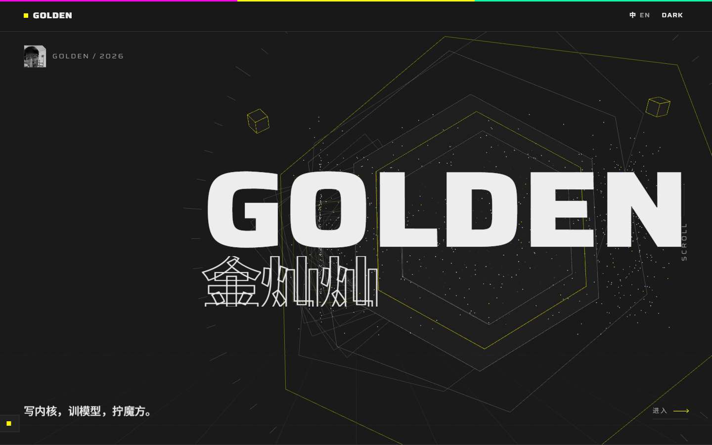

# GOLDEN · 金灿灿

个人博客 / 作品集。深色工业界面，单一信号黄，**整页 3D**：加载页、首屏、章节构造、演示图、魔方全部是真 3D 场景，文字与画面用机械动效组装进场；首页只留必要信息，往下滚才逐章展开。

打开方式：**双击 `index.html`**（不需要构建、不需要服务器）。离线也能用，字体与图片都已本地化。



---

## 变体卡

```
变体：夜班（yellow / neutral / standard / grid / standard / full）+ 浅色主题可切换
主视觉：六边形核心 + 参数点云；章节背景是一层会重建的 3D 方块构造；演示图是独立的小 3D 场景
页面类型：首屏展示页；其余阅读页
```

固定规则：唯一强调色只做填充 / 切角表示可点击 / 宽体英文配粗体中文 / 编号日期计数都是真实数据 / 1px 细线分区 / 机械短动效 / 圆角为 0。

---

## 3D 在哪里

| 位置 | 3D 内容 | 动态 |
|---|---|---|
| 加载页 | three.js 立方体阵装配 + 扫描线 | 装配、扫描、快门擦开 |
| 首屏 | 六边形核心、表盘环、参数点云 | 缓慢旋转、指针视差、单次扫描 |
| 整页背景 | 一层可重建的 3D 方块构造（每章换形状：轮廓 / 技能柱 / 画框 / 层叠 / 拱门 / 魔方 / 打印机 / 猫头 / 相机 / 传送门） | 进入新章节时从散落状态重新组装 |
| 第 02 章演示图 | 4 个独立 3D 场景：堆叠盘 + 扫描线 / 二十面体 + 轨道环 / 三层节点网络 / 切片立方 | 持续旋转、呼吸、切换技能组时重建 |
| 第 03 章演示图 | 4 个独立 3D 场景：机架、节点图、监视器波形、张量晶格 | 持续旋转/波动，切换作品时重建 |
| 第 07 章演示图 | 真 3D 打印机：框架、龙门、喷头、逐层生长的打印件 | 喷头绕圈、打印层循环生长 |
| 第 07 章过场 | 「打印城市」：程序化生成的深圳 CBD——平安金融中心、京基100、春笋、深交所、市民中心、春茧、周边楼群与深圳湾，逐个楼栋从地面长起，打印前沿扫过城市 | 第一次滑到本章自动播放：大字 + 小字引入 → 3D 打印城市（层数 000→118）→「深圳」浮出 → 城市退为本章背景 |
| 第 04 章架构图 | SVG 数据流 + 3D 透视面板 | 前向/反向脉冲、KV cache、掩码扫描 |
| 第 06 章 | 真 3D 魔方 | 打乱/还原/拖动旋转/计时 |
| 第 08 章 | 3D coverflow 照片墙：5 张照片沿弧线排开、带景深与倒影式侧卡 | 自动轮播、拖拽/按钮切换、点击中心开灯箱 |
| 章节之间 | 巨型空心字滚动带（令牌 / 注意力 / 采样 / 训练 / 推理 / 迭代…） | 跟随滚动位移 + 滚动速度倾斜 |
| 切章瞬间 | 全屏扫描线与数字栅格闪帧（0.5s） | 由当前章节号触发 |
| 演示框（头像、照片、拼图、架构图、作品详情） | 指针驱动的 3D 倾斜（perspective + rotateX/Y） | 跟手倾斜，离开回正 |
| 文字 | 每个字独立成字块，机械裁切升起（clip-path + translate），标题按字数自适应错开 | 一次入场；章节编号首次出现时乱码后落定 |

手机端为了性能会关闭 3D 构造与 3D 演示图，保留对应的线稿与 2D 入场（内容不丢）。

---

## 每个模块的出场方案

不重样，2D / 3D / 两者结合分开用：

| # | 模块 | 类型 | 怎么出场 |
|---|---|---|---|
| 01 | 关于我 | 2D + 3D | 顶部扫描线 → 头像框从右侧深度翻出 → 头像上扫过一道黄线 → 数据从 000 滚到真实值 → 正文逐字出现（背景是 3D 人像轮廓方块） |
| 02 | 技术栈 | 3D 主导 | 行位从左通电并闪黄线 → 右侧观察窗从深度推入 → 模型从 0.28 倍缩放 + 0.9rad 转回、像机库上电；切换技能时模型硬切重建 |
| 03 | 作品 | 3D + 2D | 行位错开落下 → 右侧观察窗像折页从上往下展开（clip-path + rotateX）→ 3D 蓝图模型重装；切换作品时模型换件 |
| 04 | 大模型 | 2D + 3D | 架构图整块从深度旋入 → 一条数据脉冲沿面板扫一遍 → 24 个阶段陆续通电 → 背景 3D 层叠构造重建 |
| 05 | 赛场 | 3D | 上下两扇 3D 快门合上再翻开，HUD 从右侧滑入 |
| 06 | 魔方 | 3D | 魔方台从下方推入，笼架归位，HUD 字段乱码落定 |
| 07 | 3D 打印 | 3D 电影 | 墨色快门过渡 → 大字小字 → 逐层打印深圳城市 →「深圳」按 28 层填出 → 城市沉底，页面正好停在介绍模块 |
| 08 | 生活 | 3D + 2D | 照片墙从深景整体推入并自动旋转，15 拼图按 38ms 逐块裁切落位 |
| 09 | 联系 | 2D + 3D | 每一行闪一道黄线，背景 3D 传送门缓慢旋转 |

## 首页的"留白"和神秘感

- 首屏只有：小头像 + `GOLDEN / 2026`、超大 `GOLDEN` 与空心 `金灿灿`、一句定位、一个「进入」。没有导航、没有目录、没有标签堆。
- 首屏背景还藏了一条向镜头推进的线框「隧道」，字标随鼠标做 3D 倾斜；往下滚动时整块首屏内容会加速缩小淡出、镜头同时向前推进。
- 滚动过首屏后，顶部才出现 **01–10 编号导航**（悬停显示章节名）；右侧出现 **章节刻度尺**，当前章黄色、悬停显名。
- 每章只保留「编号 + 标题 + 内容」，删掉了小字眉标、`01/10` 计数、重复导语与页脚说明。

## 九个章节

01 关于我 / 02 我在做这些 / 03 旧作与新作 / 04 从零训到 1B / 05 赛场 / 06 两天到 sub35 / 07 从屏幕到实物 / 08 镜头、车、关卡 / 09 直接找我。

第 07 章的特殊流程：滑到本章、且本章在视口里露出 2/3 后，先由两扇墨色快门合上再拉开作为过渡，随后大字与小字按机械擦入出现；约 2.2 秒后 3D 打印机开始把深圳城市集群逐层打印（楼栋按 12 层/14 层分级长起、当前打印面上有黄色层顶，层数 000→118），等「深圳」二字按 28 层逐层填充出现并停留，过场退场、城市沉到本章背景，最后页面**正好停在 3D 打印介绍模块顶部**，版面重新组装进场。全程可「跳过」或按 Esc，章节底部有「重播 3D 城市」。

文字入场：每个字都拆成独立字块，按字数自适应错开（每字约 8–26ms），用机械裁切升起的方式出现；标题容器同时做一次轻微深度推进，章节大号编号首次进入时「乱码后落定」。首屏 GOLDEN / 金灿灿 也按字依次升起，只播一次，不随滚动或悬停抖动。

「依次构建画面、最后出现文字」的编排：关于 / 大模型 / 3D 打印 / 生活这几章会先让 3D 物体与画框从深度组装（约 0.5–0.8s），文字延后 520–760ms 才开始逐字出现；技能 / 作品 / 赛场 / 魔方 / 联系则让列表或版面先就位，文字随后。

每一章另外都有一条一次性的入场装配：章节顶部一条细扫描线自上而下扫过、标题下的细线从左画出、章节数字乱码落定；关于的数据会从 000 滚到真实值，技能与联系的行会依次闪一道黄线，生活的拼图块会按 38ms 逐块落位，照片墙与魔方各有一段深度进场。

---

## 目录

```
index.html                  页面骨架（内容由 content/i18n.js 注入）
assets/
  css/font.css              Saira 可变字体（wdth 50–125 + wght 100–900），base64 内嵌
  css/main.css              设计 token、版式、3D 入场、章节构造与演示图样式
  css/arch.css              大模型架构图样式
  js/app.js                 双语、主题、滚动、刻度尺、3D 倾斜、加载时序、拼图、灯箱
  js/construct.js           整页 3D 构造层（three.js 实例化方块，每章重建）
  js/textfx.js              逐字文字入场（拆字、错开、机械擦入）
  js/specimen.js            3D 观察窗：02 技能模型、03 作品蓝图、07 打印机（移植自旧版 boke3 的 SkillScene 思路）
  js/arch.js                大模型架构图（SVG + CSS + JS，无依赖）
  js/loader.js              加载页 3D：立方体阵装配 + 扫描线
  js/hero.js                首屏 3D：六边形核心、表盘环、参数点云
  js/city.js                第 07 章过场：3D 打印深圳城市集群（纯程序化几何）
  js/cube.js                可交互 3×3×3 魔方
  vendor/three.min.js       three.js r149 UMD（MIT）
  vendor/lenis.min.js       Lenis 1.1.20 UMD（MIT）
  fonts/                    Saira 源文件 + OFL 许可证
  img/                      头像、生活照片墙、favicon
content/i18n.js             全部中英文案与联系方式（唯一需要改内容的文件）
preview/                    首屏 / 关于 / 技能 / 作品 / 大模型 / 赛场 / 字带 / 打印城市过场（快门/标题/打印/深圳/落位） / 3D 打印 / 生活 / 浅色 / 手机 / 整页
research/                   开源调研、魔方验收报告、架构图说明
tools/qa/                   本地视觉与交互验收脚本（Playwright，可选）
```

## 改内容

所有文案在 `content/i18n.js`，`zh` 和 `en` 两份结构完全一致。列表由 JS 渲染；静态句子由 HTML 里的 `data-t="section.key"` 决定。

联系方式在 `contact.items`：QQ `3816355077 / 23589533`、微信 `cancan-888888`、邮箱 `Jcc110407@outlook.com`、Bilibili `Golden金灿灿`。QQ / 微信是复制按钮，邮箱 / B 站在新窗口打开。

## 交互

- 加载：立方体阵装配 → 扫描线 → 字标落定 → 快门擦开进首屏（可点击 / 回车跳过）
- 导航：首屏不显示导航；滚动后出现 01–10 编号导航 + 右侧章节刻度尺；≤1180px 收进 MENU
- 语言：右上 `中 / EN`；主题：`DARK / LIGHT` 或 `L` 键，记忆在 localStorage
- 3D 演示：技能 / 作品切换时演示图重建；3D 打印循环生长
- 第 07 章：过场自动播一次；「跳过」/ Esc 立即结束；「重播 3D 城市」重新播放；城市沉为背景后缓慢环绕
- 大模型：播放/暂停、训练模式、重放、MoE 开关、点阶段看说明
- 魔方：打乱 → 还原（按倒序解）→ 计时与步数；拖动旋转
- 照片：3D coverflow 自动轮播，可左右拖拽 / 按 ← →，点中间那张开灯箱
- 按钮与卡片带轻微磁性吸附（桌面端）
- 生活：照片点击开灯箱（← → / Esc）；15 拼图可打乱/复原
- 联系：点 `复制` 复制号码；点 `打开` 打开邮箱 / B 站
- 系统「减少动态效果」：动画、3D 旋转、脉冲停止，内容完整；无 WebGL：3D 层自动关闭，页面照常

## 验收

```
cd tools/qa
npm i playwright
npx playwright install chromium
node final.js       # 全量冒烟 + 生成 preview/ 截图（含 3 个 3D 演示图非空校验）
node v3full.js      # 章节截图、3D 演示像素、帧率、手机回退、减少动效、无 WebGL
node c2.js          # 第 07 章过场：标题 / 打印 / 深圳 / 退场四段截图与状态
node d1.js          # 过场在手机、减少动效、浅色、无 WebGL 下的回退
node t1.js          # 逐字入场：拆字数量、播放状态、字标稳定性、中英切换重播
node b1.js          # 首屏字标倾斜/退出、kinetic 带、coverflow 切换、灯箱、切章闪帧
node v2interact.js  # 刻度尺跳转 / 技能 / 作品 / 灯箱 / 拼图 / 主题语言 / 魔方
node archtest.js    # 架构图模式、语言、主题
node cube-final.js  # 魔方打乱-还原、减少动效、重挂载
```

其它冒烟脚本默认带 `?nocine=1`，跳过第 07 章过场以便快速翻页；想看完整过场就去掉这个参数（或直接双击 `index.html`）。脚本用 `file://` 直接打开页面，与用户双击打开的环境一致。

## 许可与来源

- three.js — MIT；Lenis — MIT
- Saira — SIL Open Font License 1.1，见 `assets/fonts/OFL-Saira.txt`
- 头像与个人照片：本人提供
- 生活照片墙为示意图（5 张），来自 [Unsplash](https://unsplash.com/license)，已下载到本地
- 第 07 章的深圳城市为**纯程序化几何**，没有使用第三方模型文件：平安金融中心 600m / 118 层、京基100 442m、中国华润大厦（春笋）392m、深圳湾岸线按公开资料与地理方位近似建模；调研过 OSM / Overpass、[OSM2World](https://github.com/OSM2World/osm2world)、[3D CityDB](https://github.com/3dcitydb/3dcitydb) 与 Sketchfab / Nexprint 上的平安金融中心模型，但当前环境无法下载或抓取，最终按公开尺寸自建
- 页面代码与文案：本仓库
